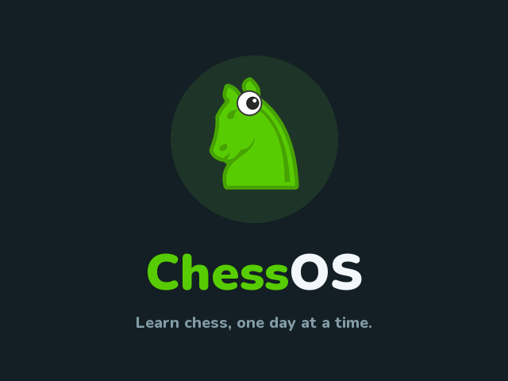
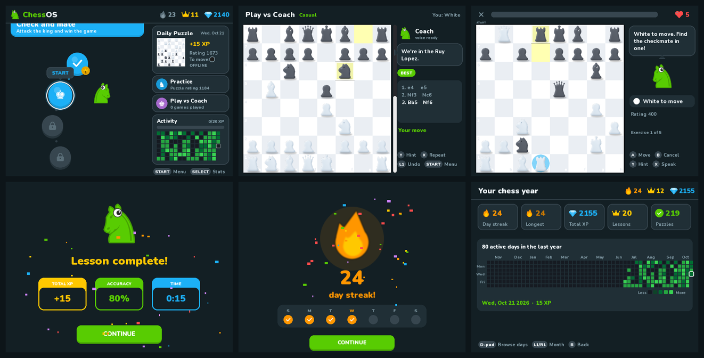
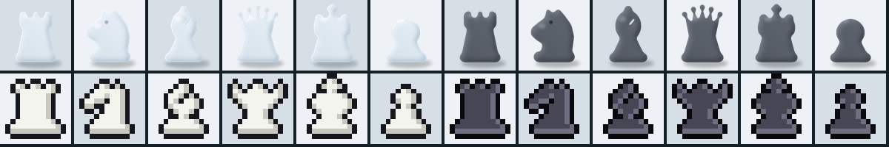
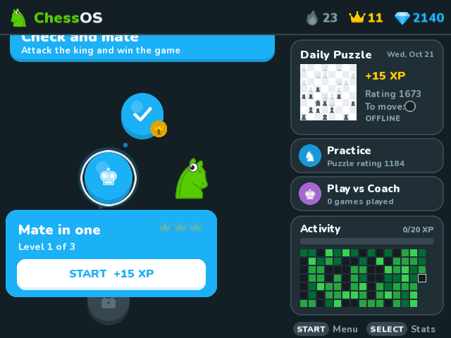
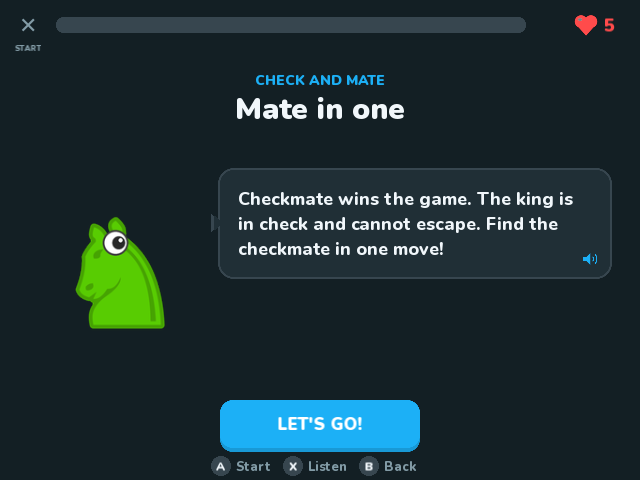
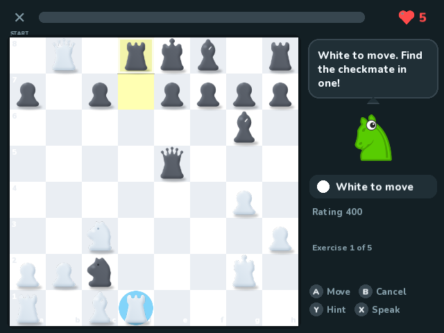
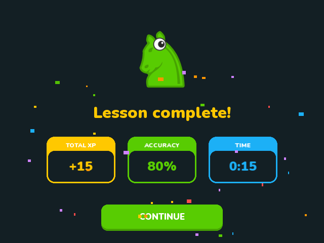
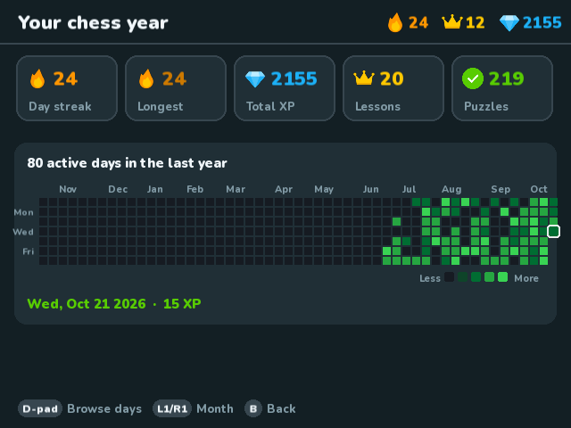
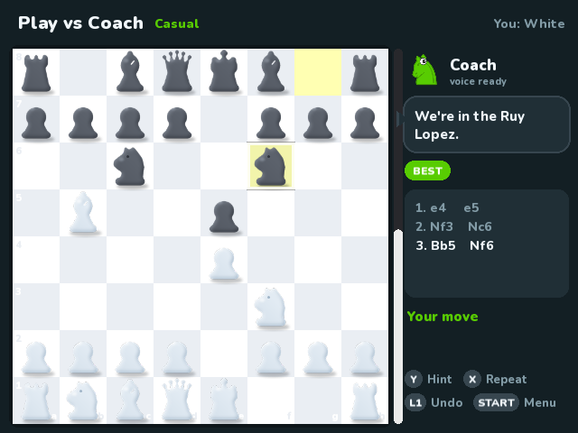

<div align="center">



# ChessOS

**Learn chess, one day at a time - on a $40 handheld.**

ChessOS turns an **R36S / K36** retro handheld into a dedicated chess trainer:
bite-sized lessons, daily puzzles, streaks and a GitHub-style activity grid, with a voice that reads your moves.
It boots straight into ChessOS. No emulators and no menus to dig through.



</div>

---

## Features

- **Lesson path.** 5 units and 23 lessons, from *how the rook moves* to forks, pins, sacrifices and endgames. Each lesson has 3 crown levels that get harder.
- **Hands-on exercises.** Collect stars with each piece, give check, then solve real puzzles. You get hearts, hints, instant feedback and confetti.
- **Daily puzzle.** Works offline from a 400-puzzle pack. With Wi-Fi, ChessOS downloads the real [Lichess daily puzzle](https://lichess.org/training/daily) and saves it as PGN.
- **Practice mode.** Endless puzzles with an Elo-style rating that adapts to you. Drop your own `.pgn` files in and they show up too.
- **Play vs Coach.** A full game against Stockfish at five strengths, Beginner to Master, with Fritz-style live commentary. Every move gets graded (best, good, inaccuracy, mistake, blunder), and the coach spots hanging pieces, forks, missed captures and mates, and names your opening. You also get hints, takebacks and an accuracy score at the end.
- **Streaks and stats.** A flame streak counter, plus every day you play becomes a square in a GitHub-style contribution grid covering the whole year.
- **Voice.** Lesson intros, feedback and every move are spoken, e.g. "knight takes e5, check".
- **Your look.** 5 colour themes (Midnight, Ice, Ocean, Plum, Forest), 3 piece sets (smooth **Soft** pieces, retro **Pixel**, **Classic**) and 5 boards, all switchable in Settings.

  
- **Animations.** Spring physics and easing modelled on [motion.dev](https://motion.dev), re-implemented for a device without a browser.
- **Made for the hardware.** D-pad controls, 640×480, runs on the 1.5 GHz quad-core RK3326 with Python 3.7. It also handles the R36S having no clock battery by asking for the date when the clock looks wrong.

## Screenshots

| Lesson path | Lesson intro | Puzzle with hint |
|---|---|---|
|  |  |  |
| **Lesson complete** | **Your chess year** | **Play vs Coach** |
|  |  |  |

## Supported hardware

| Device | Status |
|---|---|
| R36S clone "K36" (`rf3536k3ka.dtb` / `rf3536k4ka.dtb`, EmuELEC-style board) | ✅ Tested - boots straight into ChessOS |
| Other R36S / RK3326 handhelds already running ArkOS | ✅ Should work as a **port** (see *Option B*) |

ChessOS's full SD-card image is built on [ArkOS-K36](https://github.com/AeolusUX/ArkOS-K36) (community ArkOS for K36 clones).
Not sure which R36S you have? If your original card's BOOT partition has an `rf3536k3ka.dtb` or `rf3536k4ka.dtb`, it's a K36 clone.

## Install

You need a Windows 10/11 PC, Python 3.9+, and for the SD card image [WSL](https://learn.microsoft.com/windows/wsl/install) with `e2fsprogs` (`sudo apt install e2fsprogs dosfstools python3-venv`).

```powershell
git clone https://github.com/Fanaperana/chessos
cd chessos
.\setup.ps1 setup     # Python tools in .venv, checks WSL
.\setup.ps1 build     # puzzles, sprites, voice, sounds, boot logo -> dist\
.\setup.ps1 run       # try it on your PC first (keyboard controls below)
```

### Option A - flash a ChessOS SD card (boots straight into ChessOS)

```powershell
.\setup.ps1 image             # downloads ArkOS-K36 (2 GB), builds work\chessos.img
.\setup.ps1 flash             # lists your disks
.\setup.ps1 flash -Disk 3     # erases disk 3 and writes the image (admin prompt, ~10 min)
```

The flash step refuses system disks and anything that isn't a USB/SD card. You also have to type the disk number a second time.

**First boot takes a few minutes.** ArkOS repairs the partition table and creates EASYROMS across the whole card, then reboots by itself. Don't switch off during this. After that, a boot takes about 30 seconds: logo, *ChessOS is starting...*, and then you're in.

### Option B - add ChessOS to an existing ArkOS card (as a port)

```powershell
.\setup.ps1 build
```

Copy `dist\EASYROMS\ports\*` to your card's `EASYROMS\ports\` and start **Ports → ChessOS**.
Optional: copy `dist\BOOT\logo.bmp` over your BOOT partition's `logo.bmp` for the ChessOS boot logo (keep a backup).

## Controls

| R36S | PC keyboard | Action |
|---|---|---|
| D-pad / left stick | Arrow keys | Move cursor |
| A | Z / Enter | Select, move a piece, continue |
| B | X / Backspace | Back, cancel selection |
| Y | V | Hint |
| X | C | Repeat the voice |
| L1 / R1 | Q / E | Jump between units or months |
| START | S / Esc | Menu: settings, power off, restart, ArkOS menus |
| SELECT | Tab | Your chess year (stats) |
| SELECT + START | - | Quit immediately |

**ArkOS menus** (in START → Power) opens the normal EmulationStation, for Wi-Fi setup, updates or games. Leaving it brings you back to ChessOS.

## Your own puzzles

Put `.pgn` files in `chessos/puzzles/custom/`. Each puzzle is a normal PGN game with a FEN header. The side to move solves it:

```pgn
[Event "Back rank"]
[FEN "6k1/5ppp/8/8/8/8/5PPP/3R2K1 w - - 0 1"]

1. Rd8# *
```

For Lichess-style puzzles, where the first move is the opponent's set-up move, add `[Premove "1"]`.

## Troubleshooting

| Problem | Fix |
|---|---|
| **Black screen after the logo** | Your panel needs a different screen file. Rebuild with `.\setup.ps1 image -Panel 1` (try 1-7), or edit `FDT` in `extlinux/extlinux.conf` on the BOOT partition to point at a `.dtb` from `ScreenFiles/Panel N/`. |
| **Only a blinking cursor** | The system is waiting on EASYROMS. Current builds make that mount optional and repair it automatically. On older cards, format the EASYROMS partition as exFAT. |
| **ChessOS doesn't start / crashes** | Read `chessos_log.txt` on the EASYROMS drive from your PC. Every run copies its log there. |
| **BOOT/EASYROMS "needs repair" on the PC** | The handheld lost power while writing. Run `.\setup.ps1 repair`. To avoid it, turn off with START → Power → Power off. |
| **Wrong date / streak broke** | The R36S has no clock battery. ChessOS asks for the date when the clock looks wrong; you can also set it in START → *Today's date*. |
| **A/B feel swapped** | START → *Swap A / B buttons*. |

## How it works

```
device/
  chessos/            the app (installed to /opt/chessos on the card)
    main.py
    app/
      chess.py        rules engine: legal moves, SAN, FEN (perft-verified)
      pgn.py          PGN reader/writer, puzzle model
      motion.py       springs, easing, keyframes, stagger (motion.dev's model)
      gfx.py          SDL2 drawing: rounded shapes, cached text, sprites
      board.py        animated board widget
      scenes/         splash, home path, lesson player, celebrations, stats, settings
      puzzles.py      packs, daily puzzle, Lichess download, practice rating
      audio.py        voice clips + live Piper voice + sound effects
      engine.py       Stockfish over UCI, non-blocking
      coach.py        move grading, tactics, openings, phrase bank
    lib/sdl2/         PySDL2 - the same copy PortMaster runs on these devices
  system/boot.sh      boot session: ChessOS → (exit) power off / restart / ArkOS menus
tools/                PC build scripts (puzzles, sprites, voice, logo, image, flashing)
setup.ps1             one entry point for everything
```

**Why Python + SDL2 and not a web app?** ArkOS has no browser or desktop, so a web UI (and motion.dev itself) can't run there. Python 3 and SDL2 already ship with ArkOS for PortMaster, so ChessOS needs nothing extra on the device.

**How the image is built.** `tools/image/build_image.sh` takes the ArkOS-K36 image and writes ChessOS into its ext4 root filesystem with `debugfs`, so no root or loop mounts are needed. It adds a systemd drop-in that starts ChessOS instead of EmulationStation, makes the EASYROMS mounts optional, and installs the boot logo on the FAT partition.

**Voice.** Neural TTS is too slow for the R36S, so every fixed line is pre-rendered with [Kokoro-82M](https://huggingface.co/hexgrad/Kokoro-82M) (Apache-2.0, voice `af_heart`) and shipped in the repo. Moves are assembled from clips ("knight" + "takes" + "e5"). Coach lines that name pieces and squares are spoken live by [Piper](https://github.com/rhasspy/piper), which runs in the background while you play. We benchmarked espeak-ng, Piper and Supertonic on the device: see [docs/tts-benchmark.md](docs/tts-benchmark.md).

## Roadmap

- [x] **Our own look.** Colour themes and original Soft / Pixel piece sets
- [x] **Open voice.** Kokoro clips ship in the repo ([benchmark](docs/tts-benchmark.md))
- [x] **Coach.** Fritz-style live commentary while you play Stockfish (Play vs Coach)
- [ ] **Coach in lessons.** The same commentary for puzzles and lesson mistakes
- [ ] **Prebuilt images** on GitHub Releases

## Credits

Puzzles from the [Lichess puzzle database](https://database.lichess.org/#puzzles) (CC0) · base system [ArkOS-K36](https://github.com/AeolusUX/ArkOS-K36) by AeolusUX, built on [ArkOS](https://github.com/christianhaitian/arkos) by christianhaitian · [PortMaster](https://portmaster.games) for proving Python + SDL2 on these devices · Nunito and DejaVu fonts · animation model from [motion.dev](https://motion.dev).

ChessOS is MIT-licensed. See [`LICENSE`](LICENSE) and [`THIRD_PARTY.md`](THIRD_PARTY.md).
