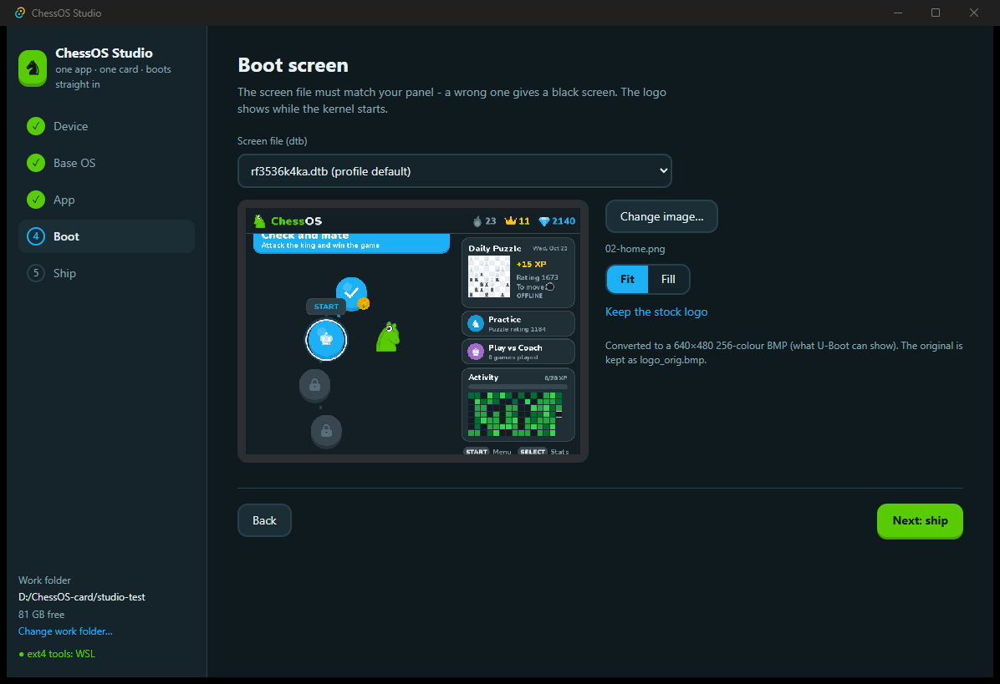

# ChessOS Studio

A desktop app (Rust + Tauri) that turns an ArkOS handheld into a single-app
device. Pick the handheld, the base OS, your app and a boot logo. Studio then
builds a ready-to-flash image and writes it to an SD card. It can also update
just the app on a card you made before, or add the app to a stock ArkOS card's
Ports menu.

It does the same job as `setup.ps1 deploy` without PowerShell, Python or
manual steps. Everything runs in Rust, apart from the ext4 tools (see below).



## Install and run

Windows 10/11, 64-bit.

1. Install the ext4 tools once. Studio uses `debugfs` and `e2fsck` from WSL to
   write into the Linux partition without mounting it:

   ```powershell
   wsl --install -d Ubuntu
   wsl -u root apt-get install -y e2fsprogs
   ```

   The sidebar shows **● ext4 tools: WSL** in green when they are found.
   Studio also uses a native `debugfs.exe` if one is on your `PATH`.

2. Build Studio (Rust and Node with pnpm needed):

   ```powershell
   cd studio
   pnpm install
   pnpm tauri build
   ```

   The installer is written to `studio\src-tauri\target\release\bundle\nsis\`.
   For development, `pnpm tauri dev` runs it with live reload.

## The five steps

| Step | What you choose | What Studio does |
|---|---|---|
| **Device** | A handheld profile, the front-end service to replace, the screen size | Loads the profile (screen, default screen file, known base images) |
| **Base OS** | A known image (downloaded for you) or any `.img` / `.img.xz` on your PC | Downloads, decompresses and caches it, then looks inside: partition table, OS version, Python, user, service, screen files, apps already installed |
| **App** | A folder with a `start` script or a `main.py`, or no app | Reads `app.json` (name, title, env prefix, tagline) and shows where it will install (`/opt/<app>`) |
| **Boot** | The screen file (dtb) and a logo image (PNG/JPG/BMP), fit or fill | Shows a live preview of the 256-colour BMP that U-Boot will display |
| **Ship** | Whole OS, Update app, or Add to Ports, and the target card | Builds the image, then writes and verifies it with administrator rights |

### Ship targets

- **Whole OS** erases the card. Studio copies the base image and sets the
  screen file and logo on the FAT boot partition. It then installs the app
  into the ext4 system partition with the boot takeover (systemd drop-in) and
  optional EASYROMS mounts, and checks the filesystem. Finally it writes the
  image (partition table last) and reads everything back to compare SHA-256.
- **Update app** keeps the card and its saves. Studio reads the system
  partition from the card, installs the new app into a copy, and writes back
  only the 4 MiB blocks that changed, verifying each one.
- **Add to Ports** needs no administrator rights. Studio copies the app to
  `EASYROMS\ports` with a launcher, plus a "Boot Mode" launcher that makes it
  start on power-on.

## Safety

- Only USB/SD/MMC disks with a card in them can be picked. System and boot
  disks are greyed out.
- Writing needs you to type the disk number, then accept the Windows
  administrator prompt.
- The elevated helper checks again that the disk is removable and the same
  size you picked before it writes anything.
- The first boot after a full flash formats EASYROMS and takes a minute longer.

## Adding a handheld

Profiles live in `studio/src-tauri/profiles.json` (built in). You can also add
your own JSON files to `%APPDATA%\dev.fanaperana.chessos.studio\profiles\`:

```json
{
  "id": "rg351p",
  "name": "Anbernic RG351P",
  "maker": "Anbernic",
  "verified": false,
  "screen": [480, 320],
  "default_dtb": null,
  "frontend_service": "emulationstation.service",
  "notes": "ArkOS for RG351P.",
  "base_images": [
    { "id": "arkos-rg351p", "name": "ArkOS RG351P", "url": "https://...img.xz",
      "file": "ArkOS_RG351P.img.xz", "size": null, "notes": "" }
  ]
}
```

Any ArkOS-family image should work if all three of these hold:
- it has a FAT boot partition and an ext4 system partition (MBR or GPT)
- its front end runs as a systemd service
- its user can run the app

The **Base OS** step shows all three before you build. Only the R36S (K36
clone) with ArkOS-K36 has been tested on hardware so far.

## How it is built

`studio/src-tauri/src/`:

| File | Job |
|---|---|
| `profiles.rs` | Handheld profiles and base images |
| `fetch.rs` | Download (resumable `.part`), `.xz` decompression, ranged copies |
| `parts.rs` | GPT/MBR reader and filesystem detection |
| `bootfs.rs` | FAT boot partition: list screen files, switch dtb (`extlinux.conf` FDT line), write `logo.bmp` |
| `splash.rs` | Any image → 8-bit RLE BMP at the screen size (NeuQuant palette) |
| `bundle.rs` | Read the app folder, stage it with LF line endings, render the boot templates from `device/system/*.in` |
| `rootfs.rs` | `debugfs` installer: repair, mkdir, write, ownership and modes, drop-in, fstab `nofail`, final check |
| `disks.rs` | Disk list (PowerShell Storage cmdlets) |
| `flash.rs` | The elevated helper (`chessos-studio.exe --helper job.json`): flash with verify, update by changed blocks |
| `pipeline.rs` | Prepare base → inspect → build image |
| `lib.rs` | Tauri commands and progress events |

The UI is a single SvelteKit page (`studio/src/routes/+page.svelte`).

Tests against a real image (they take a few minutes and are skipped by default):

```powershell
cd studio\src-tauri
$env:STUDIO_TEST_IMG = "D:\path\arkos.img"
$env:STUDIO_TEST_APP = "E:\CODE\chessos\device\chessos"
$env:STUDIO_TEST_WORK = "D:\studio-test"
cargo test -- --ignored --nocapture
```

## Limits

- Windows only for now. Disk listing and the elevated helper use Windows APIs.
  The image build itself is portable.
- A build needs about twice the image size free in the work folder (around
  20 GB for ArkOS-K36). You can change the folder in the sidebar.
- ArkOS-K36's system partition is 8 GB and already 94% full, so an app can
  use about 360 MB there (ChessOS uses 136 MB). Put large data on EASYROMS.
- Apps that need a build step (for example ChessOS's `build.ps1`, which
  downloads engines and voices) must run it before you pick the folder.
